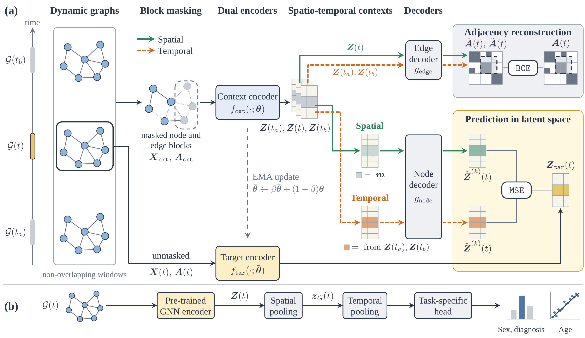

<div align="center">

# ST-JEMA: Spatio-Temporal Joint-Embedding Masked Autoencoder

**Joint-Embedding Masked Autoencoder for Self-supervised Learning of Dynamic Functional Connectivity from the Human Brain**

Jungwon Choi, Hyungi Lee, Byung-Hoon Kim, Juho Lee

[](https://arxiv.org/abs/2403.06432)
[](https://www.python.org/)
[](https://pytorch.org/)
[](LICENSE)

</div>

Official PyTorch implementation of **ST-JEMA**.

ST-JEMA is a self-supervised pre-training framework for dynamic functional connectivity (FC) graphs from resting-state fMRI. It shifts generative self-supervised learning from low-level feature reconstruction toward high-level representation learning: masked node representations are predicted in the latent space from spatial and temporal contexts, while an auxiliary edge decoder reconstructs the masked adjacency. Pre-trained on 40,913 UK Biobank subjects, ST-JEMA attains the best average rank against 16 self-supervised baselines in gender classification, age regression, and psychiatric diagnosis classification across eight datasets, and remains effective when labeled data are limited.

This repository also provides **ST-MAE** ([Choi et al., Temporal Graph Learning Workshop @ NeurIPS 2023](https://arxiv.org/abs/2312.01994)), our previous generative framework that reconstructs the input node embeddings and edges. Both methods share the same encoder and fine-tuning code.

## Contents

- [Overview](#overview)
- [Installation](#installation)
- [Data preparation](#data-preparation)
- [Pre-training](#pre-training)
- [Fine-tuning and evaluation](#fine-tuning-and-evaluation)
- [Reproducing the paper](#reproducing-the-paper)
- [Repository structure](#repository-structure)
- [Citation](#citation)
- [License](#license)

## Overview

<p align="center">
    
</p>

**(a) Pre-training.** For each sliding window *t*, the dynamic graph 𝒢(*t*) is built from the windowed FC matrix of the ROI time series.
- **Block masking.** Blocks of nodes and their edges are masked. The **context encoder** *f*<sub>cxt</sub>(·; θ) encodes the masked graphs, and the **target encoder** *f*<sub>tar</sub>(·; θ̄), an exponential moving average (EMA) of the context encoder, encodes the unmasked graph at *t*.
- **Node decoder** *g*<sub>node</sub> (MLP-Mixer). It predicts the target representations of the masked block in the latent space from two contexts: a *spatial* context, in which the masked positions are filled with a learnable mask vector **m**, and a *temporal* context from windows *t<sub>a</sub>* and *t<sub>b</sub>* that do not overlap with *t*. The loss is the MSE to the target representations.
- **Edge decoder** *g*<sub>edge</sub>. It reconstructs the masked adjacency entries along the same spatial and temporal paths with a binary cross-entropy loss.

**(b) Fine-tuning.** The pre-trained GNN encoder is followed by spatial and temporal pooling and a task-specific head for classification (sex, diagnosis) or regression (age). Use `--freeze_encoder` for linear probing.

## Installation

```bash
git clone https://github.com/jungwon-choi/ST-JEMA.git
cd ST-JEMA

conda create -n stjema python=3.11 -y
conda activate stjema

pip install torch==2.2.0 --index-url https://download.pytorch.org/whl/cu121
pip install -r requirements.txt
```

The code is tested with Python 3.11 and PyTorch 2.2 (CUDA 12.1). `torch_scatter` is only needed for the GAT encoder (`encoder_type: gat`):

```bash
pip install torch_scatter -f https://data.pyg.org/whl/torch-2.2.0+cu121.html
```

## Data preparation

Place the ROI time series and the phenotype table of each dataset under `data/`:

```
data/
└── {dataset}/
    ├── {dataset}_roi-{roi}.pkl    # dict {subject_id: ndarray [T, N]}
    └── {dataset}.csv              # 'subject_id' column + target columns
```

| File | Format |
|---|---|
| `{dataset}_roi-{roi}.pkl` | Dictionary from subject ID (str) to an array of shape `[time points, ROIs]`, the mean preprocessed BOLD signal within each ROI (Schaefer atlas with 400 ROIs in the paper). |
| `{dataset}.csv` | One row per subject with a `subject_id` column and the target column named in the config (e.g., `sex`, `interview_age`, `DX`). |

The paper uses the following datasets. Access to each dataset follows its own data use agreement.

| Dataset | Subjects | Diagnosis (P / C) | Role |
|---|---:|---:|---|
| [UK Biobank](https://www.ukbiobank.ac.uk/) | 40,913 | – | pre-training |
| [ABCD](https://abcdstudy.org/) | 9,111 | – | gender, age |
| [HCP-YA](https://www.humanconnectome.org/study/hcp-young-adult) | 1,093 | – | gender, age |
| [HCP-D](https://www.humanconnectome.org/study/hcp-lifespan-development) | 632 | – | gender, age |
| [HCP-A](https://www.humanconnectome.org/study/hcp-lifespan-aging) | 724 | – | gender, age |
| [HCP-EP](https://www.humanconnectome.org/study/human-connectome-project-for-early-psychosis) | 176 | 120 / 56 | gender, age, diagnosis |
| [ABIDE](https://fcon_1000.projects.nitrc.org/indi/abide/) | 884 | 408 / 476 | gender, age, diagnosis |
| [ADHD200](https://fcon_1000.projects.nitrc.org/indi/adhd200/) | 669 | 280 / 389 | gender, age, diagnosis |
| [COBRE](https://fcon_1000.projects.nitrc.org/indi/retro/cobre.html) | 173 | 89 / 84 | gender, age, diagnosis<sup>†</sup> |

<sup>†</sup> Multi-class diagnosis (bipolar disorder, schizophrenia, schizoaffective disorder, and controls).

## Pre-training

```bash
python pretrain.py \
    --config configs/pretrain_stjema.yaml \
    --data_dir ./data \
    --output_dir ./output/pretrain \
    --fold 0 \
    --gpu 0
```

Use `--config configs/pretrain_stmae.yaml` to pre-train ST-MAE instead.

Outputs in `--output_dir`:

| File | Content |
|---|---|
| `model/<fold>/best_model.pth` | Model with the lowest validation SSL loss (used for fine-tuning by default) |
| `model/<fold>/model.pth` | Model at the last epoch |
| `pretrain.log`, `config.yaml` | Training log and resolved config |

## Fine-tuning and evaluation

**Classification** (e.g., sex or diagnosis)

```bash
python finetune.py \
    --config configs/finetune_classification.yaml \
    --data_dir ./data \
    --output_dir ./output/finetune_sex \
    --pretrain_dir ./output/pretrain \
    --fold 0 \
    --gpu 0
```

**Regression** (age)

```bash
python finetune.py \
    --config configs/finetune_regression.yaml \
    --data_dir ./data \
    --output_dir ./output/finetune_age \
    --pretrain_dir ./output/pretrain \
    --fold 0 \
    --gpu 0
```

**Linear probing**: add `--freeze_encoder`. **Evaluation only**: add `--eval_only` to evaluate a fine-tuned model in `--output_dir`.

Outputs in `--output_dir`:

| File | Content |
|---|---|
| `model/<fold>/model.pth` | Fine-tuned model |
| `finetune.log`, `config.yaml` | Training log with test metrics and resolved config |

Reported metrics include AUROC and F1 (macro-averaged for multi-class) for classification, and MAE, normalized MAE, and Pearson correlation for regression.

## Reproducing the paper

The provided configs follow the paper; each option is documented in the YAML files.

- **5-fold cross-validation.** Results are averaged over 5 folds. All folds load the pre-trained model of fold 0 (`fix_pretrain_k: 0`):
  ```bash
  for k in 0 1 2 3 4; do
      python finetune.py --config configs/finetune_classification.yaml \
          --data_dir ./data --output_dir ./output/finetune_sex \
          --pretrain_dir ./output/pretrain --fold $k --gpu 0
  done
  ```
- **Dynamic graphs.** Window size 50 and stride 16 for UK Biobank, ABCD, and the HCP datasets; window size 16 and stride 3 for ABIDE, ADHD200, and COBRE.
- **Time series length.** During training, a random segment of `dynamic_length` time points is cropped from each subject: 400 for UK Biobank, HCP-A, HCP-D, and HCP-EP; 380 for ABCD; 600 for HCP-YA; 70 for ABIDE and ADHD200; and 120 for COBRE. Test sets use the full-length time series (`eval_full_length: true`).
- **Optimization.** Fine-tuning uses a learning rate of 5e-4 for classification and 1e-3 for regression, with weight decay selected from {1e-3, 5e-4, 1e-4}.

## Repository structure

```
ST-JEMA/
├── pretrain.py          # pre-training (ST-JEMA or ST-MAE)
├── finetune.py          # fine-tuning, linear probing, and evaluation
├── configs/
│   ├── pretrain_stjema.yaml
│   ├── pretrain_stmae.yaml
│   ├── finetune_classification.yaml
│   └── finetune_regression.yaml
├── models/
│   ├── backbone.py      # STAGIN backbone (GIN/GAT, readout, temporal modules)
│   ├── stjema.py        # ST-JEMA: block masking, EMA target encoder, node/edge decoders
│   ├── stmae.py         # ST-MAE: random masking, input reconstruction
│   ├── losses.py        # SSL losses (MSE, SCE, BCE)
│   └── components.py    # shared modules (MLP-Mixer, edge converter)
├── data/
│   ├── dataset.py       # dataset loading and k-fold splits
│   └── bold.py          # sliding-window dynamic FC
├── utils/               # config loading, seeding, metric logging
├── assets/
└── requirements.txt
```

## Citation

If you find this work useful, please cite:

```bibtex
@article{choi2024joint,
  title   = {Joint-Embedding Masked Autoencoder for Self-supervised Learning of Dynamic Functional Connectivity from the Human Brain},
  author  = {Choi, Jungwon and Lee, Hyungi and Kim, Byung-Hoon and Lee, Juho},
  journal = {arXiv preprint arXiv:2403.06432},
  year    = {2024}
}

@inproceedings{choi2023generative,
  title     = {A Generative Self-Supervised Framework using Functional Connectivity in fMRI Data},
  author    = {Choi, Jungwon and Keum, Seongho and Yun, EungGu and Kim, Byung-Hoon and Lee, Juho},
  booktitle = {Temporal Graph Learning Workshop (NeurIPS 2023)},
  year      = {2023}
}
```

## License

This project is released under the [MIT License](LICENSE).
